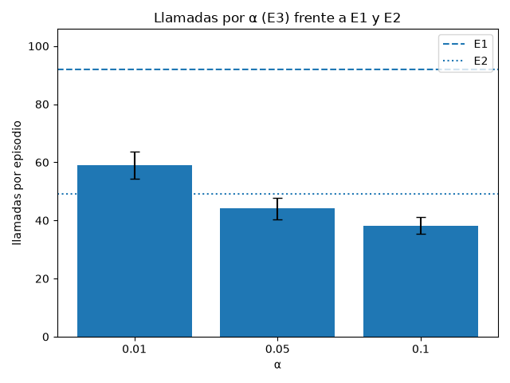
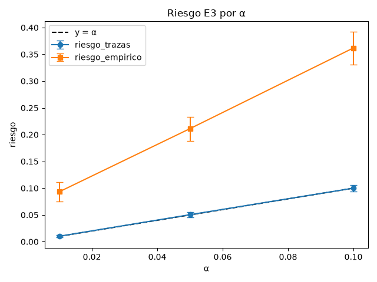
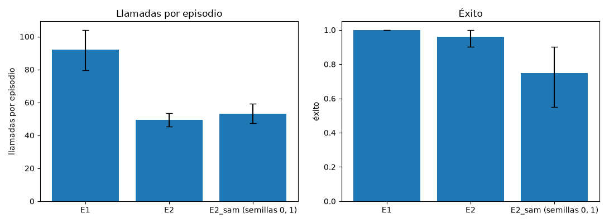
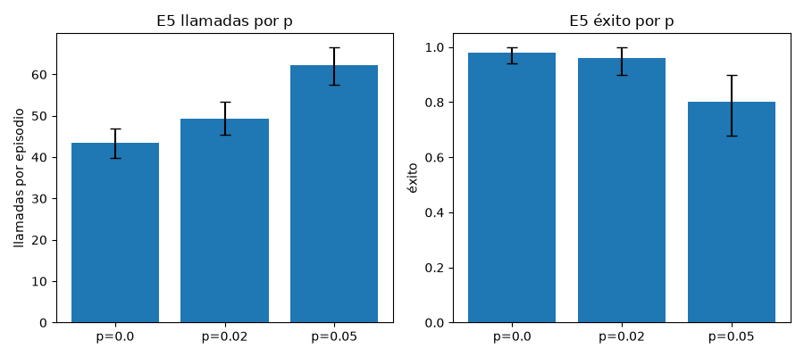

# ATISBO-SPEC

Un modelo pequeño aprende de trazas a predecir las próximas acciones de un agente. Mientras confía en lo predicho, el agente actúa sin preguntar; si no, decide Muse Spark. La pregunta es cuántas llamadas se ahorran y qué cuesta. Respuesta corta: E2 baja de 92.05 a 49.26 llamadas por episodio con éxito 0.96 frente a 1.00, y la hipótesis H1 no se cumple.

## Built during the hackathon

Antes del evento existía un proyecto propio con el mismo nombre: un modelo pequeño en numpy que anticipa hacia dónde se mueve un agente. Aquí se reconstruyó la idea desde cero para otra tarea, predecir las próximas acciones del agente, sin reutilizar su código. El código del proyecto (`atisbo/`, `demo/` y `tests/`) se escribió durante el hackathon de Meta (27 oct – 4 nov 2026). `.agents/` y `AGENTS.md` son habilidades de proceso, con gates y vetos, creadas o adaptadas para Muse a partir de lo aprendido usando otras IAs. No son parte del producto, y dos de sus scripts, `banco.py` y `vetos.py`, son anteriores al hackathon.

## How Meta models are used

Muse Spark (`muse-spark-1.3`) es la política: decide la acción cuando Atisbo no confía o cuando salta la sorpresa, y en E1 decide todos los pasos. En total, los experimentos suman 27 950 llamadas al LLM, contando también lo servido desde la caché.

SAM 3.1 (`sam-3.1`) se usa en E2_sam: una imagen PNG por paso con el prompt `colored square`, y el estado se reconstruye desde las máscaras, con un seguidor que recuerda lo que el bot tapa. En total son 2367 imágenes. Se usa imagen y no vídeo porque el lazo no conoce los fotogramas futuros.

## Resultados

H1 pedía llamadas como mucho 0.3 de E1 y éxito al menos E1 menos 5 pp; no se cumple en ninguna variante. El ratio de llamadas es 0.535 y −4 pp en E2, 0.577 y −25 pp en E2_sam, y 0.479 y −36 pp en E3 con α = 0.05.

Cómo leer las tablas: cada episodio pide llevar objetos a sus cubos en un mundo de 12 × 12 que se perturba con probabilidad p por paso, 0.02 salvo en E5. E1 es la referencia: Muse Spark decide todos los pasos. En E2, Atisbo ejecuta bloques de hasta 3 acciones si su confianza llega a τ, y la sorpresa, la distancia entre el estado predicho y el observado, devuelve el control al LLM. E3 elige τ con conformal risk control (CRC) para un riesgo objetivo α. El riesgo es la fracción de pasos en que se acepta una acción de Atisbo distinta de la de la rutina. E4 quita piezas de E2 y E5 cambia p. Los IC95 son bootstrap sobre medias por episodio. Con todo éxito dan 1.00–1.00, y eso no significa certeza. El de riesgo en trazas remuestrea episodios de test con λ fijo, así que no incluye la variabilidad de la calibración.

| Experimento | Episodios | Llamadas por episodio | IC95 | Éxito | IC95 |
|---|---:|---:|---:|---:|---:|
| E1: Muse Spark decide cada paso | 20 | 92.05 | 79.55–104.00 | 1.00 | 1.00–1.00 |
| E2: Atisbo, τ = 0.5 | 50 | 49.26 | 45.42–53.42 | 0.96 | 0.90–1.00 |
| E2_sam: E2 con estado desde SAM 3.1 | 20 | 53.10 | 47.30–59.10 | 0.75 | 0.55–0.90 |
| E3: CRC, α = 0.01 | 50 | 59.10 | 54.46–63.54 | 1.00 | 1.00–1.00 |
| E3: CRC, α = 0.05 | 50 | 44.06 | 40.28–47.88 | 0.64 | 0.52–0.76 |
| E3: CRC, α = 0.1 | 50 | 38.12 | 35.32–41.18 | 0.18 | 0.08–0.28 |
| E4: sin sorpresa | 50 | 49.26 | 45.50–52.96 | 0.96 | 0.90–1.00 |
| E4: horizonte 1 | 50 | 56.88 | 52.36–61.32 | 0.96 | 0.90–1.00 |
| E5: p = 0 | 50 | 43.52 | 39.88–46.98 | 0.98 | 0.94–1.00 |
| E5: p = 0.05 | 50 | 62.22 | 57.48–66.60 | 0.80 | 0.68–0.90 |

| α | τ por semilla (mín–máx) | Riesgo en trazas | IC95 | Riesgo en lazo cerrado | IC95 |
|---:|---:|---:|---:|---:|---:|
| 0.01 | 0.58–0.73 | 0.0102 | 0.0076–0.0130 | 0.093 | 0.075–0.111 |
| 0.05 | 0.28–0.33 | 0.0505 | 0.0453–0.0554 | 0.211 | 0.188–0.233 |
| 0.10 | 0.16–0.17 | 0.1000 | 0.0932–0.1063 | 0.362 | 0.331–0.392 |

E2 ahorra el 46.5 % de las llamadas. Con α = 0.01 se ahorra el 35.8 % y es el único punto sin fallos en sus 50 episodios; E2 falla 2 de 50, y esa diferencia tampoco se distingue del ruido. El riesgo en lazo cerrado es 9.3, 4.2 y 3.6 veces α para α = 0.01, 0.05 y 0.1. Sin sorpresa no se detecta efecto con p = 0.02: las medias coinciden por azar y por semilla difieren, 57.80 frente a 55.10 en la semilla 3. No se midió sin sorpresa con p = 0.05, donde salta 1.20 veces por episodio. El horizonte 3 sí ahorra frente a 1: 49.26 frente a 56.88 sin perder éxito, 0.96 en ambos, aunque los IC95 se solapan un poco. Con p = 0.05 el éxito cae a 0.80. El vídeo `demo/out/lazo.mp4` se genera con los comandos de Reproducción y muestra un episodio elegido a mano: el 4 de la semilla 0, con 87 pasos y 27 llamadas, el que menos llama de esa semilla; la media de E2 es 49.26, y el episodio 0 de esa semilla falla.

## Limitaciones y resultados negativos

- H1 es falsa: ninguna variante llega al 0.3 pedido, y al bajar τ el ahorro se paga con éxito.
- E1 corre en otro mundo que E2–E5: semilla 0 frente a Mundo(1000 + s). Los ratios, ahorros y deltas frente a E1 son aproximados, aunque el veredicto de H1 no depende de eso.
- CRC se cumple en trazas y no en lazo cerrado: el riesgo en lazo cerrado es 9.3, 4.2 y 3.6 veces α para α = 0.01, 0.05 y 0.1. El lazo visita otros estados y ejecuta las acciones 2 y 3 del bloque, que la calibración no cubre. Y la garantía en trazas es aproximada: los pasos solo son intercambiables por episodio.
- La sorpresa casi nunca salta: 0.26 llamadas por sorpresa por episodio.
- E2_sam: percepción del 100 % en el bot y del 97.3 % en el estado completo, pero éxito 0.75 con IC95 0.55–0.90 frente a 0.90 de E2 en las mismas semillas. Con 20 episodios esa caída no se distingue del ruido. Y SAM sale más caro que el propio LLM: 5.92 $ frente a 1.38 $ en esos 20 episodios.
- Mundo de juguete de 12 × 12 con una rutina que lo resuelve; no se extrapola a tareas reales.
- Las celdas de E4 y E5 comparten estados iniciales pero no van pareadas.
- Coste estimado con tokens por precio publicado, no factura.
- El replay exacto depende del entorno: Windows 11, Python 3.13.2, torch 2.15.0+cpu y numpy 2.5.4. Con otras versiones los pesos pueden variar y salir `CacheMiss`. En Linux no está comprobado.

## Reproducción

Primero sin clave, y sin red tras instalar. Para el replay exacto usa las versiones de Limitaciones. En Linux el intérprete es `.venv/bin/python`.

~~~
python -m venv .venv
.venv\Scripts\python.exe -m pip install -e ".[test,demo]"
.venv\Scripts\python.exe -m pytest -q
.venv\Scripts\python.exe -m tarfile -e replay/cache.tar.xz .
.venv\Scripts\python.exe -m atisbo.exp.e1 --seed 0 --n 20 --p 0.02 --max-llm-calls 3500 --modo replay --out results/E1.json
.venv\Scripts\python.exe -m atisbo.exp.e2 --max-llm-calls 3500 --modo replay --out results/E2.json
.venv\Scripts\python.exe -m atisbo.exp.e2 --estado sam --seeds 0,1 --max-llm-calls 3500 --modo replay --out results/E2_sam.json
.venv\Scripts\python.exe -m atisbo.exp.e3 --max-llm-calls 9000 --modo replay --out results/E3.json
.venv\Scripts\python.exe -m atisbo.exp.e4 --max-llm-calls 12000 --modo replay --out results/E4.json
.venv\Scripts\python.exe -m atisbo.exp.e5 --max-llm-calls 12000 --modo replay --out results/E5.json
~~~

El tope cuenta lo servido desde la caché. Tras correrlos, `git diff results/` solo debe cambiar `fecha_utc`, `commit`, `llamadas_red` y los campos de modo.

Después los artefactos:

~~~
.venv\Scripts\python.exe -m demo.registro --seed 0 --episodio 4 --out results/registro_E2_seed0.json
.venv\Scripts\python.exe -m demo.video_lazo --episodio results/registro_E2_seed0.json --out demo/out/lazo.mp4
.venv\Scripts\python.exe -m demo.figuras --results results --out demo/out
.venv\Scripts\python.exe -m demo.figuras --results results --out docs/figuras
.venv\Scripts\python.exe -m demo.resumen --results results --out results/resumen.json
~~~

## Uso de Meta Model API

- `ATISBO_LLM` elige api, replay o simulada, y `--modo` tiene prioridad sobre la variable.
- Clave solo por entorno: `META_API_KEY`. Nunca en el repo.
- El tope por defecto de `--max-llm-calls` se queda corto: usa el de cada comando.

~~~
.venv\Scripts\python.exe -m atisbo.exp.e1 --seed 0 --n 20 --p 0.02 --max-llm-calls 3500 --cache cache/llm --modo api --out results/E1.json
.venv\Scripts\python.exe -m atisbo.exp.e2 --modo api --max-llm-calls 3500 --out results/E2.json
.venv\Scripts\python.exe -m atisbo.exp.e2 --modo api --estado sam --seeds 0,1 --max-llm-calls 3500 --out results/E2_sam.json
.venv\Scripts\python.exe -m atisbo.exp.e3 --modo api --max-llm-calls 9000 --out results/E3.json
.venv\Scripts\python.exe -m atisbo.exp.e4 --modo api --max-llm-calls 12000 --out results/E4.json
.venv\Scripts\python.exe -m atisbo.exp.e5 --modo api --max-llm-calls 12000 --out results/E5.json
~~~

- E2 corre 50 episodios (5 semillas × 10); E3, 3 valores de α × 50 episodios; E4 y E5, 3 celdas × 50 episodios.
- `--modo replay` reproduce sin red desde `cache/`, y lo que falte da `CacheMiss`. `replay/cache.tar.xz` trae la caché de LLM y SAM: peticiones y respuestas, sin cabeceras ni clave.
- `tests/fixtures/llm` trae los dos primeros episodios de E1 sacados de `cache/llm`.

## Consola en vivo

`demo/vivo.py` corre un episodio en el navegador y muestra cada llamada a `muse-spark-1.3` y `sam-3.1`, con su latencia, sus tokens y su respuesta. El mundo es simulado y las llamadas son reales. Un botón mueve el objeto más cercano al bot en pleno episodio. Sirve solo en local, pide la clave sin eco si falta y nunca la envía a la página.

~~~
.venv\Scripts\python.exe -m demo.vivo --modo api
.venv\Scripts\python.exe -m demo.vivo --modo simulada
~~~

`--modo simulada` no usa red, clave ni modelos de Meta. Sirve para ensayar, y la página lo avisa.

## Coste de la evaluación

| Experimento | Episodios | Llamadas al LLM | Por episodio | Éxito | Coste estimado | Sin Atisbo (estimado) |
|---|---:|---:|---:|---:|---:|---:|
| E1: Muse Spark decide cada paso | 20 | 1841 | 92.05 | 1.00 | 2.36 $ | — |
| E2: Atisbo, τ = 0.5 | 50 | 2463 | 49.26 | 0.96 | 3.15 $ | ≈ 4 600 |
| E2_sam: E2 con estado desde SAM 3.1 | 20 | 1062 | 53.10 | 0.75 | 7.30 $ | ≈ 1 800 |
| E3: CRC, α = 0.01 | 50 | 2955 | 59.10 | 1.00 | — | ≈ 4 600 |
| E3: CRC, α = 0.05 | 50 | 2203 | 44.06 | 0.64 | — | ≈ 4 600 |
| E3: CRC, α = 0.1 | 50 | 1906 | 38.12 | 0.18 | — | ≈ 4 600 |
| E3 en total | 150 | 7064 |  |  | 9.31 $ | ≈ 13 800 |
| E4 en total | 150 | 7770 |  |  | 9.98 $ | ≈ 13 800 |
| E5 en total | 150 | 7750 |  |  | 10.03 $ | ≈ 13 800 |

- En total, los seis JSON suman 27 950 llamadas y 42.14 $ estimados.
- Sin Atisbo son los episodios por 92.05, la media de E1, donde Muse Spark decide todos los pasos. Es una estimación, porque E1 corre en mundos distintos de los de E2 y E3: semilla 0 frente a Mundo(1000 + s). Sin Atisbo, los 200 episodios de E2 y E3 habrían pedido unas 18 400 llamadas; con Atisbo fueron 9527.
- El ahorro no es gratis: cuanto más acepta Atisbo, más baja el éxito. Por eso la columna Éxito va al lado.
- El coste estimado multiplica los tokens por el precio publicado de muse-spark-1.3 (https://dev.meta.ai/docs/pricing-rate-limits). E3, E4 y E5 cuentan también lo servido desde la caché: de las 7064, 7770 y 7750 llamadas de E3, E4 y E5 fueron a la red 5530, 2204 y 3429. En E2_sam fueron a la red 2171 de las 2367 imágenes. El coste de E2_sam suma 1.38 $ de LLM y 5.92 $ de SAM. Los experimentos comparten caché, y por eso la factura real es menor que la suma.
- Las llamadas van en serie, una tras otra.
